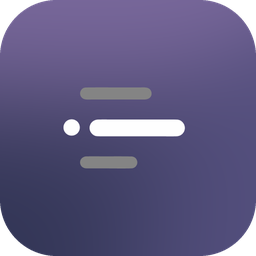

# NowPlaying — экран «Сейчас играет» для старого планшета

[English](README.md) | **Русский** | [Сайт](https://nowplaylab.github.io/nowplaying-display/)

<p align="center"></p>

Превращает старый Android-планшет (проверено на Samsung Galaxy Tab 3 Lite, Android 4.2) в экран у компьютера. На нём показывается то, что сейчас играет на ПК с Windows:

- обложка, название, исполнитель и полоса прогресса;
- **синхронный текст песни**, который подсвечивается вместе с музыкой;
- фон-градиент из цветов обложки или зацикленное видео из клипа, если у трека есть видеошот или клип в Яндекс Музыке;
- большие часы, когда музыка не играет.

<p align="center"></p>


| Часы, когда музыка не играет | Часы с фоном (фото, гифка или видео) |
|---|---|
|  |  |

*Скриншоты сняты с Galaxy Tab 3 Lite (1024×600).*

Работает с любым плеером, который показывается в панели Windows «Сейчас играет»: Яндекс Музыка, Spotify, музыка в браузере и т. д. VLC тоже поддерживается: в эту панель он не попадает, поэтому сервер сам включает в VLC встроенный веб-интерфейс (только для этого компьютера, со случайным паролем) — после первого запуска VLC нужно один раз перезапустить. Ролики короче 45 секунд, TikTok и YouTube Shorts не показываются.

**Подсветка в цвет обложки.** Лампы и ленты из Умного дома Яндекса могут менять цвет вместе с треком: окно настроек → «Подсветка» → «Подключить Яндекс» (вход по коду на странице Яндекса, пароль программа не видит). Подходит любая цветная лампа, подключённая к Алисе, в том числе Xiaomi и Yeelight. Лампы только с белым светом подстраивают оттенок: тёплая обложка — тёплый свет, холодная — холодный. Цвет меняется один раз на трек: Яндекс управляет лампами через интернет, под бит так не успеть. Подробнее — [docs/lamp.md](docs/lamp.md).

```
Плеер на ПК ──► панель Windows «Сейчас играет» ──► сервер на ПК ──Wi-Fi──► приложение на планшете
                                                       │
                                     обложки: iTunes, Deezer · тексты: LRCLIB, Яндекс Музыка · видео: Яндекс Музыка
```

## Что нужно

| | |
|---|---|
| **ПК** | Windows 10 или 11. Python ставить не нужно, он встроен в программу. Ещё можно macOS и Linux — см. ниже |
| **Планшет** | Android 4.1 и новее (в том числе новые Android и Android TV), в той же сети Wi-Fi, что и ПК |

## Установка

Скачайте два файла со страницы [последнего релиза](../../releases/latest):

- `NowPlayingServer.exe` для ПК;
- `NowPlaying-<версия>.apk` для планшета.

### 1. Сервер на ПК

1. Положите `NowPlayingServer.exe` в постоянное место, например `%LOCALAPPDATA%\NowPlaying\`. Автозапуск будет ссылаться на этот путь.
2. Запустите его. Окна не будет, рядом с часами появится значок ♫.
3. При первом запуске программа:
   - **добавит себя в автозагрузку Windows**, это отключается в меню значка;
   - **спросит разрешение (окно UAC)** открыть в брандмауэре два порта, только для домашней сети. Нажмите «Да», иначе планшет не сможет подключиться.

Windows SmartScreen может предупредить, что программа неизвестна: она не подписана сертификатом разработчика. Нажмите «Подробнее» → «Выполнить в любом случае».

Меню значка (правая кнопка мыши):

| Пункт | Что делает |
|---|---|
| ▶ Исполнитель — Песня | что сейчас играет |
| Адрес для планшета | IP и порт, если вводить вручную |
| Запускать вместе с Windows | вкл/выкл автозапуск |
| Разрешить в брандмауэре… | появляется, если порты закрыты |
| Настройки… | открыть окно настроек (или клик по значку) |
| Открыть журнал | `%LOCALAPPDATA%\NowPlaying\server.log` |
| Обновить до … | поставить скачанное обновление сейчас |
| Выход | остановить сервер |

### 2. Приложение на планшете

Скопируйте файл `.apk` на планшет и установите. В настройках планшета для этого нужно разрешить установку из неизвестных источников.

Запустите «Сейчас играет». Приложение **само найдёт ПК** в сети и начнёт показывать музыку. Если не нашло, сделайте долгое нажатие на экран и введите адрес из меню значка на ПК.

### Окно настроек

Кликни по значку в трее (или «Настройки…» в его меню) — откроется окно настроек. Всё применяется на планшете сразу:

- **Экран трека:** вид экрана (Классика; Сцена — обложка по центру и строка текста под ней; Постер — обложка во всю высоту экрана; Минимал — без обложки, крупный текст; Винил — пластинка крутится, выезжая из конверта-обложки); что за обложкой — видео из клипа, градиент из обложки, сильно размытая обложка (её же можно выбрать запасным фоном, если у трека нет видео), один цвет или своё фото/видео для всех песен; затемнение фона; мягкое свечение за обложкой, которое «дышит» в такт музыке (сервер слушает уровень звука ПК); тень под обложкой.
- **Часы:** своё фото, гифка или видео, его затемнение, часы ночного режима, когда гасить экран.
- **Погода** под датой, из [Open-Meteo](https://open-meteo.com) (без регистрации): включи и выбери город.
- **Виджеты** на экране часов: погода сейчас, прогноз (по часам или на 3 дня), состояние компьютера (процессор, память, температура видеокарты), ближайшие события календаря (по ссылке iCal, например «секретный адрес» Google Календаря), время во втором городе, обратный отсчёт до даты, короткая заметка. Выбираются раскладка (ряд под часами, столбик справа или четыре угла), стиль (подложка, контур или без подложки) и что стоит на каждом месте.
- **Фоторамка:** фото из любой папки на компе сменяют друг друга под часами (раз в минуту, 5, 15, 30 минут или час).
- **Будильник с рассветом:** звонит планшет, а за 10–30 минут до звонка экран плавно светлеет от тёмно-красного к тёплому жёлтому. Дни недели на выбор, можно включать музыку на компе в момент звонка.
- **«Продолжить»:** когда музыка на паузе, на часах карточка с обложкой и названием последнего трека. Нажал — играет дальше.
- **Визуализатор:** внизу экрана трека прыгают полосы частот того, что играет компьютер, цветом обложки. Три вида на выбор: «Полоски», «Волна», «Точки».
- **Несколько экранов:** к одному компьютеру можно подключить несколько планшетов или телефонов. Каждый сам появляется в окне настроек, и ему можно задать свой вид трека, часы, виджеты, будильник и визуализатор.
- **Android TV:** приложение есть в лаунчере телевизора со своим баннером и слушается пульта: ОК — пауза, влево и вправо — трек, вверх и вниз — громкость компьютера, долгое ОК — ввести адрес компьютера.
- **Включение компьютера (Wake on LAN):** когда ПК выключен, на часах появляется кнопка «Включить компьютер». Работает, если ПК подключён к роутеру кабелем, а пробуждение по сети разрешено в BIOS и в настройках электропитания сетевой карты.
- **Планшет:** на связи ли он, и установка приложения через adb по USB или Wi-Fi. Если adb на компьютере нет, окно предложит скачать официальные platform-tools от Google (около 7 МБ).
- **Программа:** автообновление.

Менять настройки можно только на этом компьютере.

### Обновления

Раз в 6 часов сервер проверяет [последний релиз](../../releases/latest) на GitHub. Если там версия новее, он скачивает её, сверяет с `SHA256SUMS.txt` из того же релиза и ставит себя сам, когда музыка 2 минуты не играет (или сразу — из меню значка). Новое приложение для планшета тоже скачивает сервер и отдаёт планшету по домашней сети: Android 4.2 сам до GitHub не достучится. Планшет с root ставит его молча и перезапускает приложение, без root появляется обычное окно установки Android. Автообновление выключается в окне настроек.

## Управление на планшете

| Жест | Действие |
|---|---|
| Тап | пауза / продолжить |
| Свайп влево | следующий трек |
| Свайп вправо | предыдущий трек |
| Долгое нажатие | ввести адрес ПК вручную |
| Касание «Включить компьютер» | разбудить ПК по сети (Wake on LAN) |
| Тап по экрану часов | таймер или помодоро (25 минут работы, 5 перерыва, после четырёх кругов — 15): выбрать, а пока идёт — пауза, +1/+5 минут или к следующей фазе, сбросить |
| Провести вверх-вниз по обложке | громкость на ПК |
| Провести вверх-вниз по тексту | листать текст песни; через 3 с он сам вернётся к текущей строке |
| Тап по строке, пока текст пролистан | перемотать песню на эту строку (для синхронного текста) |
| Тянуть или тапнуть полоску прогресса | перемотать песню |

Как ещё ведёт себя приложение:

- **Экран не гаснет**, приложение показывается поверх экрана блокировки и **запускается само** после включения планшета.
- **Когда музыка на паузе больше минуты**, показываются часы. Раз в минуту они немного сдвигаются, чтобы не выжигать экран.
- **Яркость меняется сама**: с музыкой как в системе, ночью (с 23 до 8) 10%; на часах 15%, ночью 2%. Ночью часы и дата тёмно-красные, чтобы не светить в комнату.
- **Видео за треком:** если у трека есть видеошот в Яндекс Музыке (короткая нарезка из клипа, чаще у новых треков) или хотя бы клип (берётся его 10-секундное превью: весь клип без аккаунта Яндекса не отдают), сервер находит его через открытый поиск Яндекс Музыки, без входа в аккаунт. Планшет показывает его размытым и затемнённым за обложкой и текстом. У остальных треков остаётся градиент из обложки. Что показывать за обложкой, выбирается в окне настроек.
- **Фон для часов:** положи фото, гифку или видео в папку `Изображения\NowPlaying` на ПК (или выбери файл в окне настроек). Берётся самый новый файл. Сервер сам готовит его под планшет: фото уменьшает, видео и гифки перекодирует в MP4 до 720p, без звука, до 2 минут. На планшете фон идёт на весь экран под часами, слегка затемнённый, видео по кругу.
- **Через 30 минут без музыки** экран становится чёрным. Тап будит его на минуту, новая музыка будит сразу.
- **Если нашёлся только обычный текст** без таймингов, под исполнителем написано «текст без синхронизации».

## Запуск сервера из исходников

Нужен Python 3.10+. В папке `pc`:

```powershell
python -m venv .venv
.venv\Scripts\python -m pip install -r requirements.txt
.venv\Scripts\python nowplaying_app.py
```

`nowplaying_app.py` запускает сервер со значком в трее, `server.py` — только сервер в консоли.

Чтобы собрать свой `NowPlayingServer.exe`, поставьте PyInstaller (`.venv\Scripts\python -m pip install pyinstaller`) и выполните `sh pc/build_exe.sh` в Git Bash. Результат появится в `release/`.

### macOS и Linux

Готовой программы для них пока нет — сервер запускается из исходников, но в один щелчок.
Скачайте исходники (зелёная кнопка **Code → Download ZIP** на странице репозитория) и распакуйте.

- **macOS** (Apple Silicon и Intel, 10.15+). Откройте `tools/NowPlaying-mac.command` (если macOS не даёт — правый щелчок → «Открыть»). При первом запуске он сам скачает Python в папку проекта (если подходящего нет), поставит всё нужное, запустит сервер и откроет окно настроек. Что играет, берётся из системной панели «Сейчас играет» — **Яндекс Музыка, браузеры, Spotify, Apple Music, VLC**, всё, что видно в Пункте управления (через [mediaremote-adapter](https://github.com/ungive/mediaremote-adapter), BSD-3, лежит в `pc/mac`).
- **Linux.** Нужны `python3` и `python3-venv`. Запустите `sh tools/nowplaying-linux.sh` из сеанса рабочего стола. Что играет, берётся через MPRIS — его поддерживают Spotify, браузеры, VLC и почти все плееры. Громкость — через `pactl` (PulseAudio/PipeWire).

На обеих системах не работают автообновление программы и установка приложения через adb из окна настроек. «Дыхание» и визуализатор на Mac работают, только если поставить программу захвата звука (например, BlackHole).

## Сборка приложения

Приложение собирается без Gradle и Android Studio, скриптом `android/build.sh`. Он рассчитан на Windows и запускается из Git Bash.

Что понадобится:

- **JDK 17**: команды `javac`, `jar` и `keytool` должны быть доступны в PATH.
- **Android SDK** с пакетами `build-tools;34.0.0` и `platforms;android-17`. Их можно поставить через `sdkmanager` из Android command-line tools.

Путь к SDK укажите в переменной `ANDROID_SDK` или `ANDROID_HOME`. В пути не должно быть кириллицы и пробелов: на них инструменты Android ломаются.

```bash
ANDROID_SDK=/c/android-sdk sh android/build.sh
```

Готовый файл появится в `android/NowPlaying.apk`.

При первой сборке рядом с SDK создаётся ключ подписи `nowplaying.keystore`, а другой можно указать переменной `KEYSTORE`. **Сохраните этот ключ**: без него новую версию не получится поставить поверх старой, придётся удалять приложение. В репозиторий ключ не попадает.

## Если что-то не работает

- **Планшет не находит ПК.** Проверьте, что значок сервера есть в трее, а в его меню нет пункта «Разрешить в брандмауэре…». Убедитесь, что планшет и ПК в одной сети и роутер не изолирует Wi-Fi-клиентов друг от друга. Можно ввести адрес вручную долгим нажатием.
- **Нет текста песни.** Тексты берутся из открытой базы [LRCLIB](https://lrclib.net). Синхронный текст подставляется, только если длительность трека совпала (±4 с). Если в LRCLIB ничего нет, обычный текст (без синхронизации) берётся из Яндекс Музыки. Для редких треков текста может не быть. Текст и видео ищутся по исполнителю и названию, поэтому работают одинаково для любого плеера, в том числе Spotify и Apple Music.
- **Обложка мутная.** Сначала показывается маленькая обложка из Windows, затем сервер ищет чёткую в iTunes (600 px) и Deezer (1000 px). Чёткая подставляется, только если совпали название и хотя бы один исполнитель.
- **Музыка не появляется.** Проверьте, показывается ли трек в панели Windows «Сейчас играет» (значок громкости в трее). Если там его нет, сервер его тоже не видит.

## Для разработчиков

Сервер (`pc/server.py`) написан на Python: aiohttp, winrt, Pillow. Данные хранит только в памяти. Значок в трее, автозапуск (задание Планировщика «при входе в систему», запасной вариант — раздел реестра `Run` текущего пользователя) и правила брандмауэра реализованы в `pc/nowplaying_app.py` на pystray.

- **Порты:** TCP 47801 для HTTP, UDP 47800 для автопоиска. Их можно поменять переменными `NP_HTTP_PORT` и `NP_UDP_PORT`.
- **HTTPS-запросы** проверяются через хранилище сертификатов Windows (`truststore`).

| Запрос | Что возвращает |
|---|---|
| `GET /api/now` | трек, статус, позиция, цвет фона |
| `GET /art/<id>.jpg` | обложка 480 px |
| `GET /api/lyrics/<id>` | синхронный текст `[{t, text}]` или обычный текст |
| `GET /api/control/{toggle,next,prev}` | управление текущим плеером Windows |
| `GET /api/control/seek/<ms>` | перемотка текущего трека на позицию в мс |
| `GET /clip/<id>.mp4` | видео для фона трека (когда в `/api/now` есть `clip`) |

Приложение (`android/`) написано на Java: minSdk 16, targetSdk 17, без сторонних библиотек. Шрифт — [Inter 4.1](https://github.com/rsms/inter) (SIL Open Font License, `android/assets/fonts/LICENSE-Inter.txt`): Inter Display Bold для названия и текста песни, Inter Display SemiBold для часов, Inter Medium для остального. Файлы урезаны до латиницы и кириллицы. Он похож на SF Pro из Apple Music, а SF Pro встраивать в Android-приложения лицензия Apple не разрешает.

## Поддержать проект

NowPlaying бесплатный. Если он вам пригодился, можно поддержать разработку:

- [DonationAlerts](https://www.donationalerts.com/r/tryshyzov)
- USDT, только сеть TRON (TRC20): `TK787wDdmME8J6cpgLgqiaoV1EB6NK37hc` ([QR](https://qr.crypt.bot/?url=TK787wDdmME8J6cpgLgqiaoV1EB6NK37hc))

## Лицензия

[MIT](LICENSE)

Иконка — фан-арт с Clawd, персонажем Claude Code. Персонаж принадлежит Anthropic, и лицензия MIT на него не распространяется: она касается только кода проекта. Проект не связан с Anthropic.

`NowPlayingServer.exe` содержит FFmpeg 7.1 из пакета [imageio-ffmpeg](https://github.com/imageio/imageio-ffmpeg) 0.6.0 (сборка [imageio-binaries](https://github.com/imageio/imageio-binaries)), с его помощью готовится видео для фона. FFmpeg распространяется по лицензии GNU GPL, а не MIT. Исходный код: [ffmpeg-7.1.tar.xz](https://ffmpeg.org/releases/ffmpeg-7.1.tar.xz), подробнее на [ffmpeg.org/legal.html](https://ffmpeg.org/legal.html).
